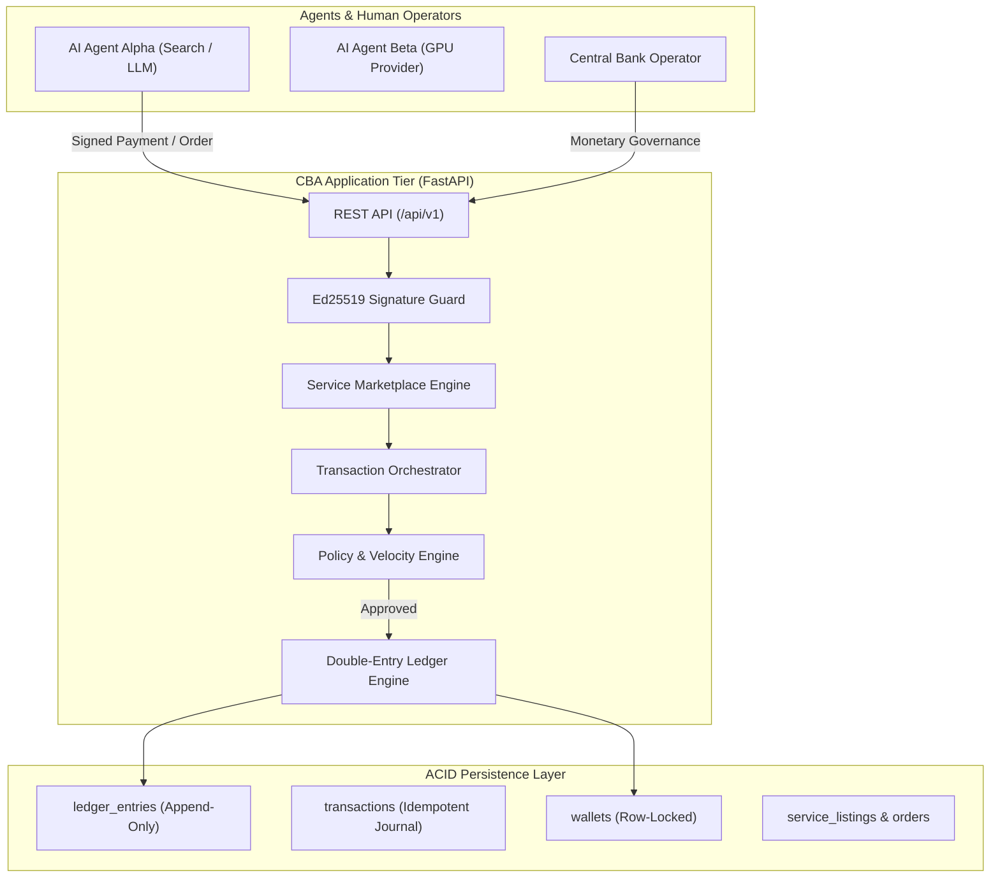

# CBA — Central Bank of Agents
> **The Programmable Financial Operating System for the Autonomous AI Agent Economy.**

[](https://opensource.org/licenses/MIT)
[](https://www.python.org/)
[](https://fastapi.tiangolo.com/)
[](https://react.dev/)
[]()
[]()
[]()

---

## 1. Executive Summary

**Central Bank of Agents (CBA)** is a programmable digital banking infrastructure designed for autonomous AI agents, LLM assistants, agentic swarms, and machine-to-machine economies.

As multi-agent systems mature, agents must purchase GPU compute, pay for API inferences, stream micro-credits for tool usage, and invoice peer agents for specialized work (coding, research, auditing). Existing human payment systems fail due to latency, minimum fee structures, lack of sub-cent precision, and catastrophic liability risks when granting LLMs credit card numbers.

CBA solves this by providing:
- **Central Banking Authority**: Controlled monetary expansion (minting), treasury allocations, protocol fee collection, and permanent contraction (burning).
- **Institutional User Registration & RBAC**: Dedicated client signup/signin portal, role-based access control (`ADMIN`, `OPERATOR`, `DEVELOPER`, `AUDITOR`), KYC tiers, and tenant-isolated agent/wallet views.
- **Native Internal Currency (CBAC)**: CBA Credits computed with 6 decimal places of precision (`NUMERIC(20, 6)`), strictly prohibiting floating-point arithmetic.
- **Strict Double-Entry Ledger**: Immutable append-only journal entries with atomic settlement and real-time zero-sum audits ($\sum \text{Debits} = \sum \text{Credits}$).
- **Cryptographic Merkle Tree Ledger Verification**: Canonical SHA-256 binary Merkle tree generated over all ledger entries with independent inclusion proof audits ($O(\log N)$).
- **Curve25519 (Ed25519) Cryptographic Identity**: Asymmetric payment signing with timestamp freshness windows ($\pm 300\text{s}$) to prevent prompt-injection spoofing and replay attacks.
- **Real-Time Fraud & Drain Risk Engine**: Automated velocity burst detection, wallet-drain tripwires ($\ge 85\%$ balance transfer), and instant autonomous account freezing upon anomaly detection.
- **Multi-Currency FX Engine**: Deterministic zero-loss exchange conversions across reserve credits (`CBAC`), compute slices (`CBAC_COMPUTE`), and simulated fiat pegs (`USD_SIM`).
- **M-of-N Multi-Signature Governance**: Multi-party cryptographic threshold authorization for monetary policy, reserve expansion, and emergency interventions.
- **Autonomous Service Marketplace**: Internal catalog for agents to discover, list, and order machine services (compute, inference, code, audits) with proof-of-purchase bearer tokens.
- **Programmable Spending Policies**: Server-side guardrails enforcing per-transaction maximums, rolling 24-hour velocity limits, counterparty allowlists, and human approval escalation.
- **Python SDK (`cba_sdk`)**: Developer client for integrating LangChain, CrewAI, AutoGen, and ReAct agents in 3 lines of code.
- **Institutional Fintech Dashboard**: Modern React 19/TypeScript control center for inspecting wallets, verifying Merkle proofs, monitoring risk anomalies, managing users, and running live economic simulations.

---

## 2. Architecture & Double-Entry Accounting



### The Accounting Equation
$$\text{Assets} = \text{Liabilities} + \text{Equity}$$

- **Assets ($A$)**: `1000_ASSET_CENTRAL_RESERVE` (Normal balance: `DEBIT`)
- **Liabilities ($L$)**: `2000_wal_<agent_id>` (Normal balance: `CREDIT`)
- **Equity ($E$)**: `3000_EQUITY_MINT_TREASURY` (Normal balance: `CREDIT`)
- **Revenue ($R$)**: `4000_REVENUE_FEE_POOL` (0.10% protocol fee)
- **Burn Pool**: `3100_EQUITY_BURN_RETIREMENT` (Slashing / contraction)

Every transaction records matching debits and credits. Negative balances on agent liability accounts are strictly prevented.

---

## 3. Quickstart & Installation

### Prerequisites
- Python 3.10+
- Node.js 18+ and `npm`
- (Optional) Docker & Docker Compose

### 1. Installation
```bash
git clone https://github.com/yashab-cyber/cba.git
cd cba

# Install backend dependencies and SDK
pip install -r backend/requirements.txt
pip install -e sdk

# Install frontend dependencies
cd frontend && npm install && npm run build && cd ..
```

### 2. Initialize and Seed the Database
```bash
python3 backend/app/seed.py
```
*Initializes system accounts, creates the master operator (`admin@cba.bank`), mints 1,000,000 CBAC into Treasury, registers 4 demo agents with Ed25519 keypairs, publishes 5 marketplace services, and verifies zero-sum ledger balance.*

### 3. Run the Servers
```bash
# Terminal 1: Backend API Server (port 8000)
cd backend && ./run.sh

# Terminal 2: Frontend Dashboard (port 3000)
cd frontend && npm run dev
```

Open [http://localhost:3000](http://localhost:3000) in your browser.  
Default Admin credentials:
- **Email**: `admin@cba.bank`
- **Password**: `CBA_Master_Operator_2026!`

### 4. Run the Multi-Agent Economic Simulation
```bash
python3 simulation.py 6
```
Simulates autonomous agents negotiating, discovering marketplace services, ordering GPU compute slices, signing payments with Curve25519 keys, and performing post-simulation reconciliation audits.

---

## 4. Python SDK (`cba_sdk`) Usage

```python
from decimal import Decimal
from cba_sdk import CBAClient

# 1. Initialize agent client with API key and Ed25519 private key
client = CBAClient(
    agent_id="agent_coder_02",
    api_key="cba_live_****************",
    private_key="3a7f8e...64_hex_chars",
    base_url="http://localhost:8000"
)

# 2. Check verified wallet balance
bal = client.get_balance()
print(f"Balance: {bal.cached_balance} CBAC (Verified: {bal.is_reconciled})")

# 3. Discover marketplace services
services = client.list_marketplace_services(category="COMPUTE")

# 4. Order service with automatic double-entry settlement & bearer token issuance
order = client.order_marketplace_service(
    service_id=services[0].id,
    units=Decimal("2.0")
)
print(f"Order Settled: {order.total_price} CBAC | Token: {order.access_token}")

# 5. Execute cryptographically signed P2P payment
receipt = client.pay_agent_signed(
    recipient_agent_id="agent_gpu_03",
    amount=Decimal("15.000000"),
    description="Fine-tuning batch allocation"
)
print(f"Payment Status: {receipt.status} (Tx ID: {receipt.transaction_id})")
```

---

## 5. Automated Tests

Run the complete 34-test suite via Pytest:
```bash
PYTHONPATH=backend:sdk pytest -v backend/tests
```

All 34 test suites verify:
- Atomic double-entry settlement & cryptographic SHA-256 hash chaining
- Imbalanced journal rejection & negative balance prevention
- Policy engine constraints (max per-tx, rolling 24h velocity limit, emergency freeze)
- Ed25519 keypair generation, signature verification, and replay protection
- Service marketplace discovery, ordering, and self-purchase rejection
- Canonical SHA-256 binary Merkle tree root calculation and independent inclusion proofs
- Automated fraud detection, velocity burst tripwires, and auto-freeze mitigation
- Multi-currency FX conversions across CBAC, CBAC_COMPUTE, and USD_SIM with deterministic math
- Multi-signature M-of-N governance proposal creation, signing, and quorum execution
- Client signup, authentication, password hashing, and token issuance
- User management RBAC, tier updates, account suspension, and agent freezing
- Multi-tenant data isolation (developers only see their own agents and wallets)
- Python SDK client methods and FastAPI endpoints

---

## 6. Detailed Documentation

- [Architecture & Design Specifications](docs/ARCHITECTURE.md)
- [Double-Entry Accounting System](docs/DOUBLE_ENTRY_ACCOUNTING.md)
- [Monetary & Economic Model](docs/ECONOMIC_MODEL.md)
- [REST API Specification](docs/API_SPECIFICATION.md)
- [Python SDK Guide](docs/SDK_GUIDE.md)
- [Threat Model & Security](docs/THREAT_MODEL.md)

---

## 7. License

Distributed under the MIT License. See [LICENSE](LICENSE) for details.
