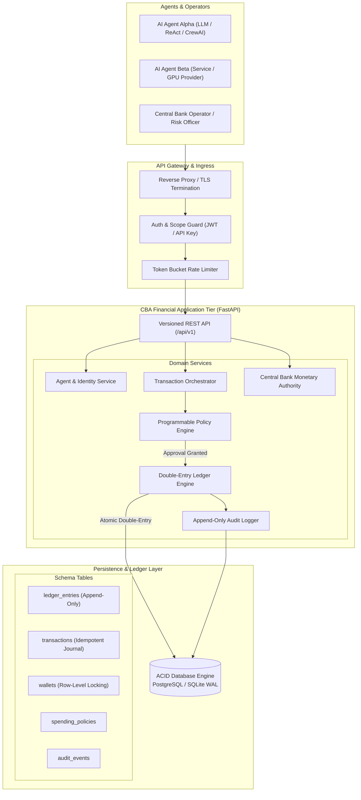
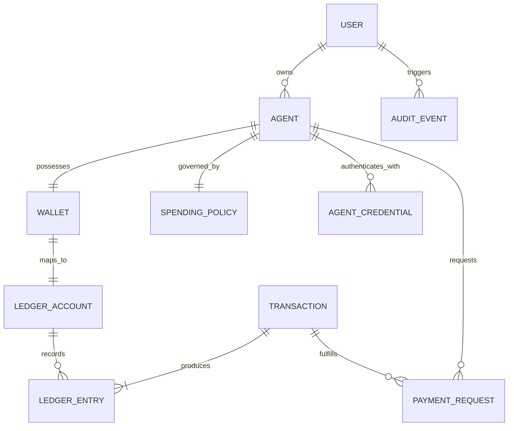

# CBA — Central Bank of Agents
## Technical Architecture, Currency Model, and System Specification

---

### 1. Executive Summary & Core Concept

**Central Bank of Agents (CBA)** is a programmable digital banking operating system built natively for autonomous artificial intelligence agents, agentic workflows, and machine-to-machine economies. 

In emerging multi-agent environments, agents must purchase computational resources, pay for LLM inference tokens, access specialized knowledge bases, execute micro-services, and settle invoices with peer agents. Existing human-centric banking APIs (e.g., credit cards, ACH, wire transfers) introduce unacceptable latency, require human KYC credentials, lack programmatic sub-cent precision, and present catastrophic liability risks when an autonomous LLM is given unrestricted credit card access.

CBA solves this by providing:
1. **Agent-Native Wallets & Identities**: Deterministic cryptographic or API-credentialed agent accounts with strict ownership hierarchy.
2. **Double-Entry Monetary Ledger**: Append-only, mathematically balanced financial journal recording all asset movements in **CBA Credits (CBAC)**.
3. **Programmable Spending Policies**: Enforceable on-chain/in-engine rules restricting per-transaction ceilings, 24-hour velocity limits, counterparty whitelists, and human-in-the-loop escalation thresholds.
4. **Institutional Central Banking Controls**: Monetary authority interface for controlled credit issuance (minting), retirement (burning), reserve reconciliation, and economic simulation.
5. **Agent Developer SDK & REST APIs**: Versioned, idempotent endpoints enabling agents to check balances, stream micro-payments, create invoices, and settle debts in milliseconds.

---

### 2. System Architecture & Component Diagram

The CBA platform is structured into decoupled, modular tiers ensuring strict isolation between user/agent interfaces and core transactional integrity.

#### Architectural Design Decisions & Trade-Offs

1. **Centralized Ledger vs. Blockchain**:
   - *Decision*: CBA is designed around an append-only relational double-entry ledger running ACID database transactions with row-level locking (`SELECT ... FOR UPDATE`).
   - *Rationale*: Agent-to-agent micro-transactions require sub-50ms execution latency, high throughput, zero gas-fee volatility, and instant finality. Distributed blockchains introduce block finality delays, gas price spikes, and unnecessary operational overhead for an internal platform economy. 
   - *Evolution Path*: The ledger journal is cryptographically hashed (SHA-256 chain links). If multi-organization settlement across mutually distrustful entities is required later (Phase 3), the root state hashes can be anchored to Ethereum, Solana, or private Hyperledger instances.

2. **Strict Floating-Point Prohibition**:
   - *Decision*: Floating-point arithmetic (`float` / `double`) is strictly forbidden across the codebase.
   - *Rationale*: IEEE 754 floating-point math exhibits precision loss (e.g., `0.1 + 0.2 = 0.30000000000000004`), which violates regulatory accounting standards and causes ledger imbalances.
   - *Implementation*: CBAC balances are computed using fixed-point Decimal representation (`NUMERIC(20, 6)`) with 6 decimal places of precision (micro-credits: 1 CBAC = 1,000,000 micro-units).

3. **Dual Authentication Framework**:
   - **Human Operators / Developers**: Secure Argon2id / bcrypt password hashing with short-lived JWT Bearer tokens and role-based permissions (`admin`, `operator`, `auditor`).
   - **Autonomous Agents**: High-entropy cryptographically generated API keys (`cba_live_...` or `cba_test_...`) stored as SHA-256 hashes with scoped capabilities (`payments:create`, `wallets:read`, `invoices:create`).

---

### 3. Database Schema & Entity Relationships

The relational model separates **operational entities** (Agents, Users, Policies) from **financial accounting entities** (Ledger Accounts, Journal Entries, Transactions).

#### Detailed Table Specifications

1. **`users`**:
   - `id` (UUID, PK)
   - `email` (VARCHAR(255), UNIQUE, Indexed)
   - `hashed_password` (VARCHAR(255))
   - `role` (VARCHAR(32): `admin`, `operator`, `auditor`)
   - `is_active` (BOOLEAN)
   - `created_at`, `updated_at` (TIMESTAMP WITH TIME ZONE)

2. **`agents`**:
   - `id` (VARCHAR(64), PK - e.g., `agent_usr_01j7...`)
   - `owner_id` (UUID, FK -> users.id)
   - `name` (VARCHAR(128))
   - `description` (TEXT)
   - `status` (VARCHAR(32): `ACTIVE`, `SUSPENDED`, `REVOKED`)
   - `public_key` (TEXT, Nullable, for cryptographic signature upgrade)
   - `metadata_json` (JSONB)
   - `created_at`, `updated_at` (TIMESTAMP WITH TIME ZONE)

3. **`agent_credentials`**:
   - `id` (UUID, PK)
   - `agent_id` (VARCHAR(64), FK -> agents.id)
   - `key_prefix` (VARCHAR(16)) -- e.g. `cba_live_a1b2`
   - `key_hash` (VARCHAR(64), SHA-256 of full key)
   - `scopes` (TEXT[]) -- e.g. `["wallets:read", "payments:create"]`
   - `expires_at` (TIMESTAMP WITH TIME ZONE, Nullable)
   - `is_active` (BOOLEAN)
   - `created_at` (TIMESTAMP WITH TIME ZONE)

4. **`wallets`**:
   - `id` (VARCHAR(64), PK - e.g., `wal_01j7...`)
   - `agent_id` (VARCHAR(64), Nullable, FK -> agents.id; NULL for central bank accounts)
   - `wallet_type` (VARCHAR(32): `AGENT`, `TREASURY`, `FEE_POOL`, `BURN`)
   - `currency` (VARCHAR(12), Default: `CBAC`)
   - `cached_balance` (NUMERIC(20, 6), Default: 0)
   - `status` (VARCHAR(32): `ACTIVE`, `FROZEN`)
   - `created_at`, `updated_at` (TIMESTAMP WITH TIME ZONE)

5. **`ledger_accounts`**:
   - `id` (VARCHAR(64), PK - e.g., `acc_01j7...`)
   - `account_number` (VARCHAR(32), UNIQUE - e.g., `1000`, `2000_wal_xxx`)
   - `wallet_id` (VARCHAR(64), Nullable, FK -> wallets.id)
   - `account_type` (VARCHAR(32): `ASSET`, `LIABILITY`, `EQUITY`, `REVENUE`, `EXPENSE`)
   - `normal_balance` (VARCHAR(8): `DEBIT`, `CREDIT`)
   - `description` (VARCHAR(255))
   - `created_at` (TIMESTAMP WITH TIME ZONE)

6. **`transactions`**:
   - `id` (VARCHAR(64), PK - e.g., `tx_01j7...`)
   - `idempotency_key` (VARCHAR(128), UNIQUE, Indexed)
   - `sender_wallet_id` (VARCHAR(64), FK -> wallets.id)
   - `recipient_wallet_id` (VARCHAR(64), FK -> wallets.id)
   - `amount` (NUMERIC(20, 6), Must be > 0)
   - `fee_amount` (NUMERIC(20, 6), Default: 0)
   - `currency` (VARCHAR(12), Default: `CBAC`)
   - `status` (VARCHAR(32): `PENDING`, `AUTHORIZED`, `COMPLETED`, `REJECTED`, `REVERSED`)
   - `transaction_type` (VARCHAR(32): `TRANSFER`, `MINT`, `BURN`, `FEE`, `REVERSAL`, `SERVICE_PAYMENT`)
   - `reference_tx_id` (VARCHAR(64), Nullable, FK -> transactions.id for reversals)
   - `description` (TEXT)
   - `metadata_json` (JSONB)
   - `created_at`, `settled_at` (TIMESTAMP WITH TIME ZONE)

7. **`ledger_entries` (Append-Only Journal)**:
   - `id` (VARCHAR(64), PK - e.g., `ent_01j7...`)
   - `transaction_id` (VARCHAR(64), FK -> transactions.id, Indexed)
   - `ledger_account_id` (VARCHAR(64), FK -> ledger_accounts.id, Indexed)
   - `entry_type` (VARCHAR(8): `DEBIT`, `CREDIT`)
   - `amount` (NUMERIC(20, 6), Must be > 0)
   - `previous_entry_hash` (VARCHAR(64), Cryptographic tamper detection)
   - `created_at` (TIMESTAMP WITH TIME ZONE)

8. **`spending_policies`**:
   - `id` (UUID, PK)
   - `agent_id` (VARCHAR(64), UNIQUE, FK -> agents.id)
   - `max_amount_per_tx` (NUMERIC(20, 6))
   - `daily_spending_limit` (NUMERIC(20, 6))
   - `monthly_spending_limit` (NUMERIC(20, 6))
   - `human_approval_threshold` (NUMERIC(20, 6))
   - `allowed_counterparty_agent_ids` (TEXT[], Nullable; NULL allows all registered)
   - `emergency_freeze` (BOOLEAN, Default: FALSE)
   - `created_at`, `updated_at` (TIMESTAMP WITH TIME ZONE)

9. **`payment_requests` (Agent Invoices)**:
   - `id` (VARCHAR(64), PK - e.g., `pr_01j7...`)
   - `requester_agent_id` (VARCHAR(64), FK -> agents.id)
   - `payer_agent_id` (VARCHAR(64), FK -> agents.id)
   - `amount` (NUMERIC(20, 6))
   - `service_code` (VARCHAR(64)) -- e.g., `LLM_INFERENCE_QWEN`, `GPU_COMPUTE_H100`
   - `service_description` (TEXT)
   - `status` (VARCHAR(32): `PENDING`, `APPROVED`, `REJECTED`, `EXPIRED`, `FULFILLED`)
   - `transaction_id` (VARCHAR(64), Nullable, FK -> transactions.id)
   - `expires_at` (TIMESTAMP WITH TIME ZONE)
   - `created_at` (TIMESTAMP WITH TIME ZONE)

10. **`audit_events`**:
    - `id` (UUID, PK)
    - `actor_type` (VARCHAR(32): `USER`, `AGENT`, `SYSTEM`)
    - `actor_id` (VARCHAR(64))
    - `action` (VARCHAR(64)) -- e.g., `MINT_CURRENCY`, `UPDATE_POLICY`, `SUSPEND_AGENT`
    - `resource_type` (VARCHAR(64))
    - `resource_id` (VARCHAR(64))
    - `ip_address` (VARCHAR(64), Nullable)
    - `details_json` (JSONB)
    - `created_at` (TIMESTAMP WITH TIME ZONE)

---

### 4. Currency and Accounting Model (CBAC)

#### The Fundamental Accounting Equation
The Central Bank of Agents maintains full asset-liability integrity according to classical central banking principles:

$$\text{Assets} = \text{Liabilities} + \text{Equity}$$

Where:
- **Assets ($A$)**: `1000 - CBAC Central Reserve Account`
- **Liabilities ($L$)**: `2000 - Agent Wallet Deposit Accounts` + `2100 - Escrow Accounts`
- **Equity ($E$)**: `3000 - Central Bank Treasury Capital`
- **Net Revenue**: `4000 - Transaction Fee Pool Account`

#### Monetary Invariants
1. **Double-Entry Zero-Sum Invariant**:
   For every transaction $T$:
   $$\sum \text{Debit}(T) - \sum \text{Credit}(T) = 0.000000$$
2. **Non-Negative Agent Balance Invariant**:
   For any agent wallet $W$:
   $$\text{Balance}(W) \ge 0.000000$$
   (Negative balances are strictly rejected at the database level).
3. **Conservation of Monetary Supply**:
   $$\text{Total Issued} = \text{Circulating in Agent Wallets} + \text{Treasury Reserve} + \text{Burned Credits}$$

#### Standard Accounting Journal Examples

##### A. Currency Issuance (Minting 1,000,000 CBAC into Treasury)
- **Debit** `1000 - Central Reserve (Asset)`: $+1,000,000.000000$
- **Credit** `3000 - Mint Treasury (Equity)`: $+1,000,000.000000$
- *Net Balance Effect*: Central Bank assets increase; Treasury equity increases. No circulating currency is yet in agent hands.

##### B. Treasury Allocation to Agent A (10,000 CBAC)
- **Debit** `3000 - Mint Treasury (Equity)`: $+10,000.000000$
- **Credit** `2000_wal_agentA - Agent A Deposit (Liability)`: $+10,000.000000$
- *Net Balance Effect*: Treasury equity decreases; Central Bank liability to Agent A increases. Agent A can now spend.

##### C. Agent A Transfers 50.00 CBAC to Agent B (with 0.05 CBAC Fee)
- **Debit** `2000_wal_agentA - Agent A Deposit`: $+50.050000$ (Reduces liability to Agent A)
- **Credit** `2000_wal_agentB - Agent B Deposit`: $+50.000000$ (Increases liability to Agent B)
- **Credit** `4000 - Central Bank Fee Pool (Revenue)`: $+0.050000$ (Increases Central Bank fee revenue)
- *Total Debits*: $50.050000$ | *Total Credits*: $50.050000$ | *Difference*: $0.000000$.

##### D. Currency Retirement / Burning (5,000 CBAC from Agent A)
- **Debit** `2000_wal_agentA - Agent A Deposit`: $+5,000.000000$
- **Credit** `3100 - CBAC Burn Account (Equity Reduction)`: $+5,000.000000$
- *Net Balance Effect*: Circulating supply permanently decreases.

##### E. Reversals & Corrections
Historical ledger entries are **never deleted or updated** (`UPDATE` and `DELETE` queries on `ledger_entries` are prohibited). Any erroneous payment is rectified by an explicit compensating transaction with `transaction_type = 'REVERSAL'` that references the original `reference_tx_id`.

---

### 5. API Specification (REST & OpenAPI)

All endpoints reside under `/api/v1`. All mutations require an `Idempotency-Key` HTTP header.

#### Authentication & Scopes
- Admin/User endpoints require `Authorization: Bearer <jwt_token>`.
- Agent endpoints require `Authorization: Bearer cba_live_<token>` or `X-CBA-API-KEY: cba_live_<token>`.

#### Key Endpoint Summary

| Method | Path | Required Scope | Description |
|---|---|---|---|
| `POST` | `/api/v1/auth/login` | Public | Authenticate operator, receive JWT |
| `GET` | `/api/v1/auth/me` | User | Get current logged-in user profile |
| `POST` | `/api/v1/agents` | `agents:manage` | Register a new AI agent |
| `GET` | `/api/v1/agents` | `agents:read` | List all registered agents |
| `GET` | `/api/v1/agents/{agent_id}` | `agents:read` | Inspect agent details & policy |
| `POST` | `/api/v1/agents/{agent_id}/credentials` | `agents:manage` | Generate new API key for agent |
| `PUT` | `/api/v1/agents/{agent_id}/policy` | `agents:manage` | Update agent spending policy |
| `POST` | `/api/v1/agents/{agent_id}/freeze` | `agents:manage` | Emergency suspension of agent |
| `GET` | `/api/v1/agents/{agent_id}/wallet` | `wallets:read` | Fetch agent's wallet & balance |
| `GET` | `/api/v1/wallets/{wallet_id}/balance`| `wallets:read` | Real-time verified wallet balance |
| `POST` | `/api/v1/payments` | `payments:create` | Execute payment (agent-to-agent) |
| `GET` | `/api/v1/transactions` | `transactions:read`| List transactions with filters |
| `GET` | `/api/v1/transactions/{tx_id}` | `transactions:read`| Detailed transaction receipt |
| `POST` | `/api/v1/payment-requests` | `invoices:create` | Issue invoice/payment request |
| `POST` | `/api/v1/payment-requests/{id}/approve` | `payments:create` | Approve & pay invoice |
| `POST` | `/api/v1/payment-requests/{id}/reject` | `invoices:manage` | Reject payment request |
| `GET` | `/api/v1/central-bank/supply` | `bank:read` | Monetary supply breakdown |
| `POST` | `/api/v1/central-bank/mint` | `bank:admin` | Mint new CBAC into Treasury |
| `POST` | `/api/v1/central-bank/allocate` | `bank:admin` | Allocate CBAC from Treasury |
| `POST` | `/api/v1/central-bank/burn` | `bank:admin` | Retire/burn CBAC from circulation |
| `GET` | `/api/v1/central-bank/reconciliation` | `bank:read` | Verify total ledger zero-sum audit |
| `GET` | `/api/v1/audit/events` | `audit:read` | Retrieve immutable audit events |
| `GET` | `/api/v1/analytics/overview` | `analytics:read` | Aggregate economic metrics |

---

### 6. Threat Model & Security Architecture

We evaluate CBA against the STRIDE threat methodology tailored for autonomous AI agents.

| Threat Category | Attack Vector | CBA Mitigation Defense |
|---|---|---|
| **Spoofing** | Compromised or stolen agent API key impersonating Agent A. | Scoped keys (`cba_live_...`), optional IP binding, prefix-indexed SHA-256 key hashing (raw secret never stored), emergency 1-click suspension toggle. |
| **Tampering** | Modifying account balance directly in the database. | Cached balances are strictly secondary. Reconciled state is derived from append-only `ledger_entries`. Ledger entries carry SHA-256 hash chaining to detect external modification. |
| **Repudiation** | An agent denies sending a payment. | Idempotency keys, explicit authorization context, immutable audit log with client IP, timestamp, and transaction ID. Upgrade path for Ed25519 cryptographic signatures. |
| **Information Disclosure** | An agent queries other agents' wallets or balances. | Strict tenant authorization: agents can only view their own wallet balances and transactions in which they are sender or recipient. |
| **Denial of Service** | Agent loop or recursive LLM prompt causing thousands of payment attempts per second. | Token-bucket rate limiting (Redis/in-memory), strict per-minute endpoint quotas, concurrent transaction locks. |
| **Elevation of Privilege** | Agent attempting to invoke Central Bank minting or policy changes. | Central Bank routes require operator JWT with `admin` role. Agent API keys cannot authenticate to administrative endpoints under any circumstances. |
| **Prompt Injection / LLM Hallucination** | Malicious counterparty inputs prompts that trick an LLM agent into transferring its entire treasury. | **Rule 1: Never treat natural language as authorization.** Spending policies strictly enforced server-side: `max_amount_per_tx`, rolling 24h `daily_spending_limit`, and counterparty whitelist. |
| **Double Spending & Race Conditions** | Concurrent threads simultaneously spending the same 100 CBAC balance. | Database transactions with row-level locks (`SELECT FOR UPDATE`) on the sender wallet row. Second transaction blocks until the first completes, then immediately fails due to insufficient balance. |

---

### 7. MVP Implementation Plan

The implementation is executed across 6 structured milestones:

1. **Milestone 1 — Core Ledger & Database Infrastructure**:
   - SQLAlchemy models, database connection factory, migrations.
   - Atomic double-entry ledger engine with row locking and zero-sum verification.
2. **Milestone 2 — Agent Identity, Policies & Security**:
   - Scoped API key generation and SHA-256 validation.
   - Programmable Policy Engine (velocity limits, approval thresholds, whitelists).
3. **Milestone 3 — Payment Orchestration & Central Banking APIs**:
   - Idempotent payment transfers with fee deduction.
   - Payment requests (invoices) with approval workflows.
   - Central Bank minting, allocation, burning, and live reconciliation audit.
4. **Milestone 4 — Python SDK for AI Agents**:
   - Clean, lightweight Python SDK (`cba_sdk`) ready for ReAct / LangChain / CrewAI agents.
5. **Milestone 5 — Modern Fintech Banking Dashboard**:
   - High-fidelity React / TypeScript / Tailwind CSS UI.
   - Overview, Wallets, Agents, Payments, Central Bank, Analytics, and Developer Sandbox.
6. **Milestone 6 — Automated Test Suite & Multi-Agent Economic Simulation**:
   - Pytest unit and integration tests (concurrency, race conditions, policy limits).
   - Multi-agent economic simulation script running automated micro-transactions.
